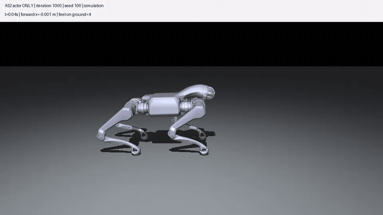
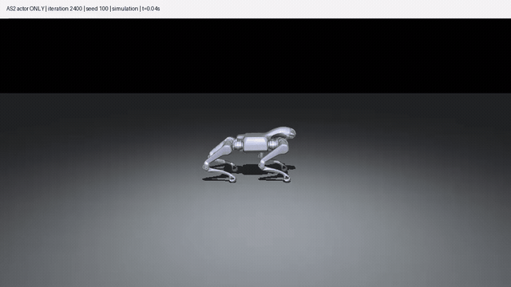

# AS2-SuperMimic

**Reference-conditioned motion imitation for Unitree AS2, from simulation to a real single jump.**

[中文](README.zh-CN.md) · [Method](docs/method.md) · [Reproduction](docs/reproduction.md) · [Results](docs/results.md) · [Sim-to-Real](docs/sim2real-integration.md) · [Provenance](docs/provenance.md)

AS2-SuperMimic learns closed-loop control conditioned on reference motion
trajectories. The policy combines recent robot observations with current and
future reference states and clip phase; a learned world model supports
gradient-based policy optimization. The release includes simulated single
forward jumps, experimental backflip motion, and single-jump sim-to-real.
This is an AS2 motion-imitation project, not the official SuperMimic repository.

| Single Forward Jump | Experimental Backflip |
| :---: | :---: |
|  |  |
| [Full policy video](docs/media/single-jump.mp4) | [Full policy video](docs/media/backflip-experimental.mp4) |

Both videos show learned actor-only rollouts in simulation, not scripted pose
playback. The backflip demonstrates learned backward rotation; contact,
joint-limit, and final-stance limitations remain documented in [Results](docs/results.md).

## Reference Motion Tracking

Reference trajectories are policy inputs, not only training videos or reward
targets. At each tick, the policy receives five sensor-history frames plus
reference states at offsets of 0.0, 0.1, 0.25, and 0.5 seconds and the clip phase.
Tracking rewards compare joint positions, root height, orientation, feet,
velocity, and root pose against the reference.

The hardware-oriented policy removes live global root-pose input while retaining
reference conditioning. Each released checkpoint is trained for one clip; this
is not a claim that one policy can execute arbitrary unseen trajectories.
See [method and observation contracts](docs/method.md).

## Included Work

| Component | Release Scope |
| --- | --- |
| Single forward jump | Reference generation, training, final checkpoint, physics evaluation |
| Experimental backflip | Reference, training, learned rotation demonstration, original evaluation records |
| Proprioceptive single jump | Training, exported NumPy actor, deployment interfaces |
| Hardware single jump | Later controller snapshot, matching deployed bundle, one completed run record |

## Sim-to-Real

The author completed a single forward jump on a physical AS2. The AGX controller
is in [hardware-single-jump](hardware-single-jump/README.md). The included log
records **400 policy steps in 7.98 seconds** and a return of control to `ai`.
The deployed bundle matches the proprioceptive export.

No hardware video is included. The source snapshot postdates the run, and the
log has no source or model hashes. See [deployment notes](docs/sim2real-integration.md)
for the version history and operating limits. Hardware scope is one forward jump.

## Evaluate A Policy

Use the validated Python environment described in [Reproduction](docs/reproduction.md).
[Download the matching Release checkpoint](checkpoints/README.md) into
`checkpoints/`, then run from this repository root:

```bash
bash tools/run.sh simulation -m as2_motion_imitation.evaluate_jump \
  --checkpoint ../checkpoints/as2-single-jump-model_1000.pt \
  --output outputs/evaluation/my-single-jump

bash tools/run.sh simulation -m as2_motion_imitation.evaluate_backflip \
  --checkpoint ../checkpoints/as2-backflip-experimental-model_2400.pt \
  --output outputs/evaluation/my-backflip --trials 20
```

The launcher changes into the selected workspace; paths in Python arguments
are relative to that workspace. Use a new output directory for each run.
The backflip evaluator intentionally retains the original physical criteria.

## Train

```bash
bash tools/run.sh simulation -m as2_motion_imitation.learner \
  --config configs/forward-jump-4096.toml \
  --output outputs/training/my-single-jump

bash tools/run.sh simulation -m as2_motion_imitation.learner \
  --config configs/backflip-4096.toml \
  --output outputs/training/my-backflip
```

Training uses reference-conditioned collection, including recorded commands
and reference-state resets. During independent evaluation, the learned actor
controls the robot using feedback and reference inputs, without a reference driver.
Each checkpoint targets one clip. Exact replay/simulator/RNG continuation is
not implemented.

## Layout

```text
as2-motion-imitation/   Simulation learning and experiments
as2-sim2real/           Proprioceptive training and earlier deployment interfaces
hardware-single-jump/   Later AGX controller snapshot and one hardware run record
tools/                 New portable launcher and test-data preparation
test-data/             Small historical fixtures required by unchanged tests
docs/                  Results, provenance, integration notes, media
checkpoints/           Download instructions; weights distributed separately
```

The workspaces deliberately retain separate copies of the same package
namespace. The hardware folder includes only its deployed inference runtime,
not a second training stack. Do not combine `PYTHONPATH` entries or interchange
incompatible checkpoint contracts.

## Attribution

Method: SuperMimic. Simulation: mjlab and MuJoCo Warp.
AS2 model: Unitree's `unitree_rl_mjlab`. Component copyright, licensing,
and implementation provenance are recorded in [third-party notices](THIRD_PARTY_NOTICES.md).

The initial upload is private, with models in draft Release `v0.1.0-rc1`.
The author's license and attribution for new contributions are pending
confirmation before public release; see [licensing status](docs/licensing.md).
