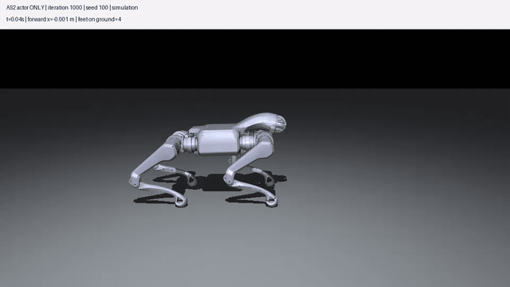
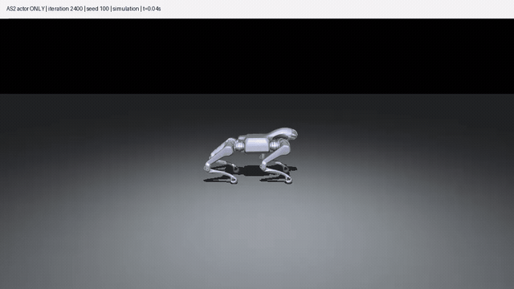
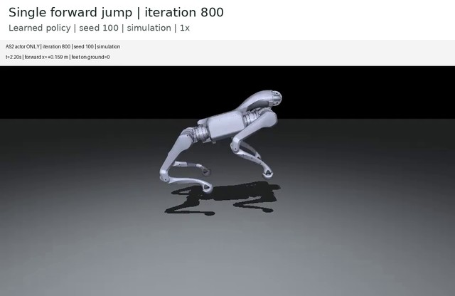
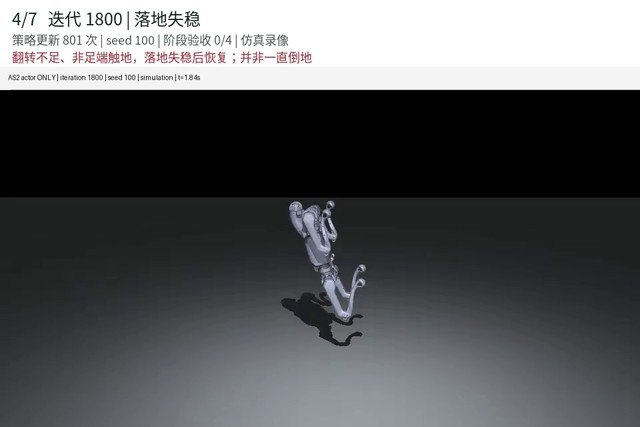
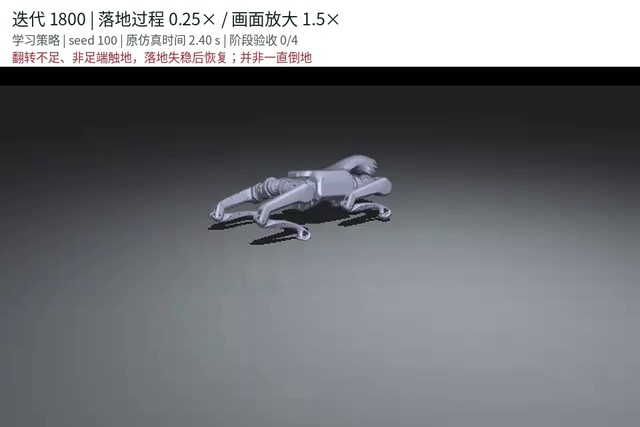

# AS2-SuperMimic

**基于参考动作轨迹的 Unitree AS2 动作模仿，从仿真学习到真机单跳。**

[English](README.md) · [方法](docs/method.md) · [训练](docs/training.md) · [复现说明](docs/reproduction.md) · [实验结果](docs/results.md) · [Sim-to-Real](docs/sim2real-integration.md) · [来源](docs/provenance.md)

AS2-SuperMimic 让 AS2 根据参考轨迹学习动作。策略读取机器人反馈、参考状态和
动作相位，在学习到的世界模型中优化，再到物理仿真中测试。
目前提供单次前跳、实验性后空翻，以及单跳的真机部署代码。
这是面向 AS2 的动作模仿工程，不是官方 SuperMimic 仓库。

| 单次前跳 | 实验性后空翻 |
| :---: | :---: |
|  |  |
| [完整策略视频](docs/media/single-jump.mp4) | [完整策略视频](docs/media/backflip-experimental.mp4) |

上面两段演示均为学习策略在仿真中的表现。后空翻已学到腾空后转动作。

## 训练过程

| 前跳阶段对比 | 后空翻阶段对比 | 后空翻落地失败 |
| :---: | :---: | :---: |
| [](docs/media/single-jump-training-stages.mp4) | [](docs/media/backflip-training-stages.mp4) | [](docs/media/backflip-landing-failures.mp4) |
| [初始、400、800、1000 次迭代 · 32.16 秒](docs/media/single-jump-training-stages.mp4) | [初始到 2400 次迭代，7 个阶段 · 56.28 秒](docs/media/backflip-training-stages.mp4) | [1800、2000 次迭代 · 28.88 秒](docs/media/backflip-landing-failures.mp4) |

这些视频来自训练期间保存的策略评估录像，保留了早期未起跳和落地失败的阶段。
阶段对比按原速播放；落地失败视频另附 0.25 倍速、1.5 倍放大的局部回放。

## 训练设备与耗时

训练使用单张 **NVIDIA RTX PRO 5000 Blackwell**，通过 MuJoCo Warp
运行 **4096 个并行物理环境**，训练种子为 23。

| 模型 | 迭代数 | 训练循环耗时 | 采集转移数 |
| --- | ---: | ---: | ---: |
| 仿真单次前跳 | 1000 | 20.1 分钟 | 18,104,320 |
| 仿真后空翻 | 2400 | 42.7 分钟 | 41,369,600 |
| 本体感知单跳（Sim-to-Real） | 1400 | 30.1 分钟 | 24,657,920 |

耗时取自各次训练日志，包含初始数据采集，不含初始化、参考轨迹搜索、独立评估和
真机部署。网络规模、batch size 等参数见[训练配置与记录](docs/training.md)。

## 参考轨迹驱动的动作模仿

参考轨迹不仅用于计算训练奖励，也直接进入策略观测：每步输入包含五帧传感器
历史，以及相对当前时刻 0、0.1、0.25、0.5 秒的参考状态和动作相位。跟踪奖励
衡量关节位置、机身高度、姿态、足端、速度和根部位姿与参考的差异。

真机方向的策略保留参考条件输入，但不依赖实时全局根部位姿。策略根据反馈生成
动作，不是直接回放录制的关节指令。当前每个发布模型对应一个训练片段，尚不代表
同一个模型能零样本执行任意新轨迹。详见[方法与观测接口](docs/method.md)。

## 本版内容

| 模块 | 内容 |
| --- | --- |
| 仿真单跳 | 参考生成、训练、模型、独立物理评估 |
| 仿真后空翻 | 参考、训练、实验性动作迁移、完整指标 |
| 本体感知单跳 | 训练、NumPy actor 导出和部署接口 |
| 真机单跳 | AGX 控制器、推理 bundle 和一次运行记录 |

## Sim-to-Real

作者实测完成了 AS2 单次前跳。代码放在
[hardware-single-jump](hardware-single-jump/README.md)，所附日志记录了
**400 个策略步、7.98 秒**的执行过程，结束后将控制权交还 `ai`。
部署 bundle 与本地 proprio 单跳导出一致。

目前未附真机视频；代码快照晚于这次日志，日志也没有记录源码和模型哈希。
具体版本关系和运行限制见[部署说明](docs/sim2real-integration.md)。

## 快速运行

先按[复现文档](docs/reproduction.md)选择已验证的 Python 环境，将[模型附件](checkpoints/README.md)
放入 `checkpoints/`，从仓库根目录运行：

```bash
bash tools/run.sh simulation -m as2_motion_imitation.evaluate_jump \
  --checkpoint ../checkpoints/as2-single-jump-model_1000.pt \
  --output outputs/evaluation/my-single-jump

bash tools/run.sh simulation -m as2_motion_imitation.evaluate_backflip \
  --checkpoint ../checkpoints/as2-backflip-experimental-model_2400.pt \
  --output outputs/evaluation/my-backflip --trials 20
```

入口会切换到对应工作区，所以 Python 参数中的路径相对于该工作区。
每次使用新的输出目录。后空翻命令仍输出原严格指标。

从头训练单跳：

```bash
bash tools/run.sh simulation -m as2_motion_imitation.learner \
  --config configs/forward-jump-4096.toml \
  --output outputs/training/my-single-jump
```

## 工程边界

- 各目录的同名 `as2_motion_imitation` 包分开运行，不混合 import 或交换不兼容的模型。
- 本版不展示或分发三跳模型；部分三跳 reference 和测试保留用于源码回归。
- 原工程不改；发布副本整理了注释和文档字符串，计算与控制逻辑保持不变。
- 模型不包含 replay、仿真器和 RNG 的完整状态，不支持精确续训。
- 仿真后空翻不作为真机后空翻成果；真机发布范围仅单次前跳。
- 当前先上传为私有仓库，模型放在 `v0.1.0-rc1` 草稿 Release；确认原创部分许可证与署名后再公开。第三方许可保持不变。

详细来源见 [THIRD_PARTY_NOTICES](THIRD_PARTY_NOTICES.md)。
